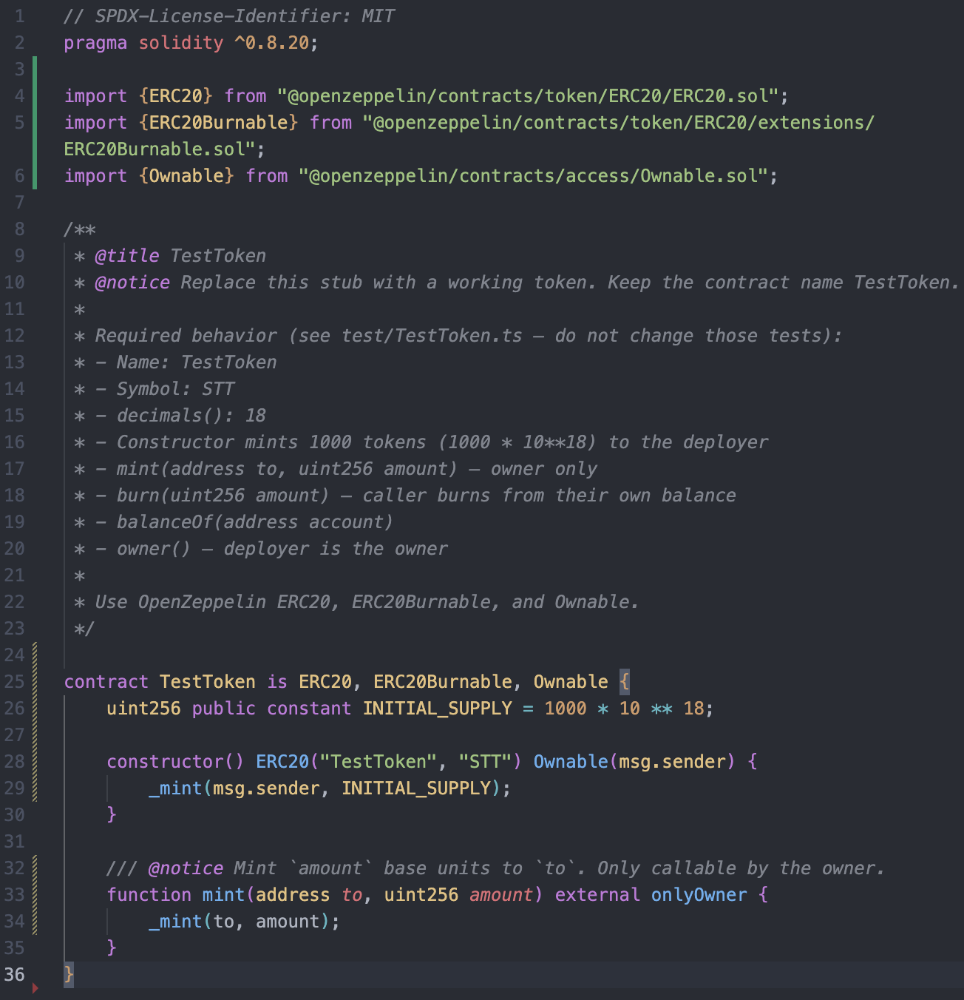
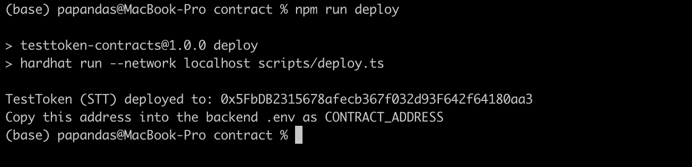
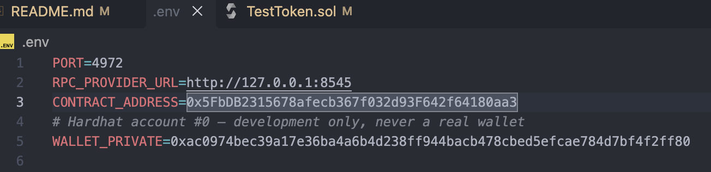
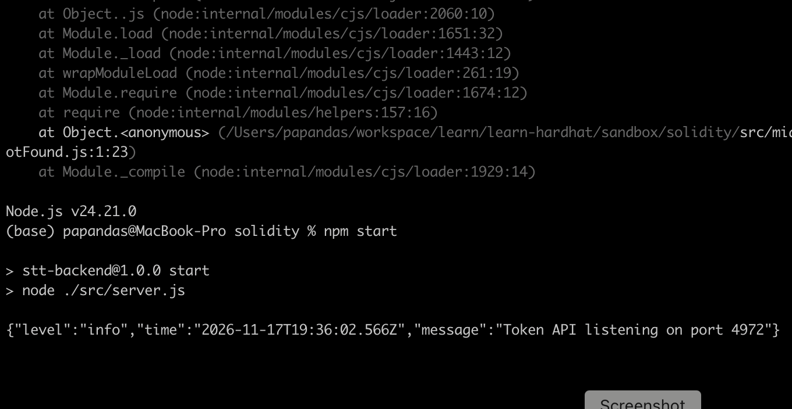
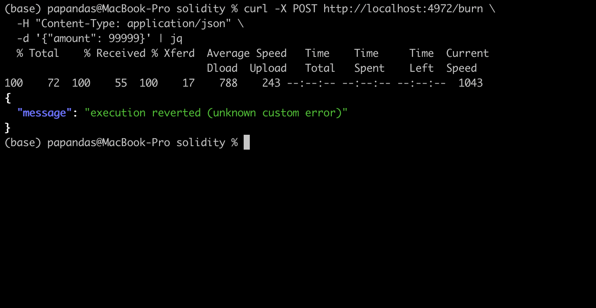
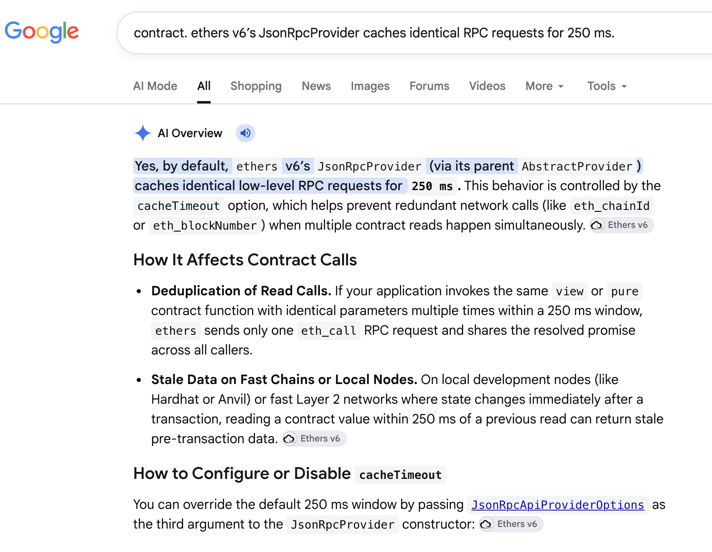
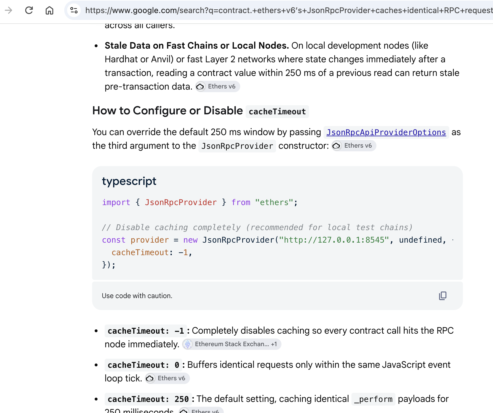
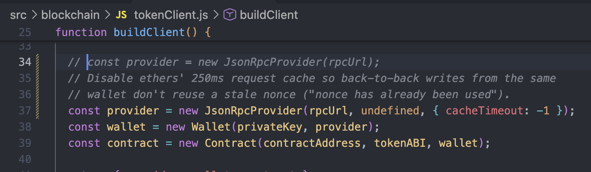
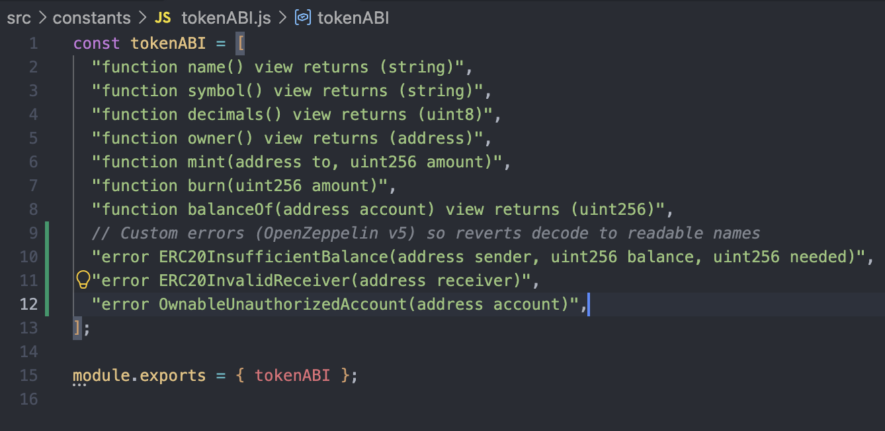

# Skill Test: Papan Das

## Getting the code 

### Step 1. Setup the GitHub repo

### Step 2. Read the task documents first.

I read the root ```README.md```, ```contract/README.md```, both package.json files and both ```.env.example``` files before touching any code. 

Task 1: implement ```TestToken.sol``` so the 7 Hardhat tests pass.
Task 2: deploy it to a local chain and connect the existing ```Express API```.

### Step 3. Read all the source code before running anything. I went through:

* the contract stub, the test file ```test/TestToken.ts```, ```hardhat.config.ts``` and ```deploy.ts```;
every backend file: server, app, config, the blockchain client, services, controllers, routes, validation, middleware and the ABI.

Those custom error names only exist in <b>OpenZeppelin v5</b>, so the contract had to be written for v5.

While reading, I found the red flag: ```src/middleware/notFound.js``` contains ```require("../../public/404.svg"). require()``` on an unfamiliar file extension runs the file as JavaScript. Run untrusted code only after you’ve looked at it, so I inspected the file next.

## The contract (Part 1 of the task)

### Step 4: Installed the contract dependencies. 

I ran ```npm install``` in ```contract/```. That pulls in Hardhat, the Hardhat toolbox (ethers, chai, the test matchers) and OpenZeppelin, as the task’s own setup instructions say.


### Step 5: Ran the tests against the untouched stub

```npm test``` 


All 7 failed, with “Not implemented” and missing custom errors, just as the README predicts. Checking the starting point first proves the test setup works, so a later green run means the code really fixed it.

### Step 6. Checked the installed OpenZeppelin version. 


### Step 7. Checked the OpenZeppelin files work with Solidity 0.8.20. 
Hardhat is pinned to 0.8.20, and some newer OpenZeppelin releases require a later compiler. Every file the token imports (ERC20, ERC20Burnable, Ownable, Context, the interfaces and the error definitions) declares ^0.8.20 or lower, so they compile fine. Skipping this check could have meant a confusing compile error.

### Step 8. Wrote the contract. 

The stub in ```contract/contracts/TestToken.sol``` 




### Step 9: Compiled and ran the tests. 

```npm run compile``` succeeded, and ```npm test``` showed 7 passing:


## Phase 3: Deploy and connect the backend (Part 2 of the task)

### Step 10. Started the local chain and deployed.

1. ```npm run chain``` started a Hardhat node at http://127.0.0.1:8545; this is a blockchain, not the API.


2. ```npm run deploy``` deployed the token and printed `0x5FbDB2315678afecb367f032d93F642f64180aa3`. That’s the usual first address on a fresh Hardhat node, so you’ll likely get the same one.




The deploy uses Hardhat account #0, so account #0 becomes the token owner.

### Step 11. Set up the backend .env and tried to start the API.

1. Copied ```.env.example``` to ```.env``` and set ```CONTRACT_ADDRESS``` to the deployed address.



2. Left ```WALLET_PRIVATE``` as the account #0 key already in the file. That key matters: it’s the same account that deployed the contract, so the API signs as the owner and POST /mint is allowed. A different key would make every mint revert.
   
3. Ran ```npm install``` and ```npm start```.


The API crashed immediately with ```SyntaxError: Unexpected token '<'``` from   ```notFound.js```. The README says the backend needs no changes, but as shipped it can never start, so evaluation point 4 (/health OK, endpoints working) couldn’t be met without a fix.

### Step 12. Fixed the 404.svg crash. 

In ```src/middleware/notFound.js```, this line:


### Step 13. Started the API and tested every endpoint. 

I used two Hardhat accounts: account #0 (the owner, which is also the backend wallet) and account #1 (call it “Alice”).




| Call	| Result	| What it proves |
| --- | --- | --- |
| GET /health	| {"status":"OK"}	| The README’s health check passes. |
| GET /balance/<owner>	| {"balance":1000}	| Initial supply went to the deployer, and the API converts base units to whole tokens. |
|GET /balance/<alice>	|{"balance":0}	|An empty address reads as 0.
|POST /mint {"to":alice,"amount":50}	|tx hash	|The owner can mint through the API.
|GET /balance/<alice>	|{"balance":50}	|The mint actually landed.|
|POST /burn {"amount":99999}	|error, reverted	|Burning more than the balance is blocked.|
|POST /mint {"to":"nope"}	|400 | Input validation works.|
|GET /does-not-exist	|404 |The fixed 404 handler works.|


Owner: 0xf39Fd6e51aad88F6F4ce6aB8827279cffFb92266
Alice: 0x70997970C51812dc3A010C7d01b50e0d17dc79C8
 
curl http://localhost:4972/health | jq

curl http://localhost:4972/balance/0xf39Fd6e51aad88F6F4ce6aB8827279cffFb92266 | jq


curl http://localhost:4972/balance/0x70997970C51812dc3A010C7d01b50e0d17dc79C8 | jq


curl -X POST http://localhost:4972/mint \
  -H "Content-Type: application/json" \
  -d '{"to": "0x70997970C51812dc3A010C7d01b50e0d17dc79C8", "amount": 50}' | jq


curl -X POST http://localhost:4972/burn \
  -H "Content-Type: application/json" \
  -d '{"amount": 99999}' | jq


curl -X POST http://localhost:4972/burn \
  -H "Content-Type: application/json" \
  -d '{"amount": 20}' | jq

curl http://localhost:4972/does-not-exist | jq



One call failed unexpectedly: a POST /burn sent right after the mint returned “nonce has already been used”.

### Step 13. Investigated the nonce error. 
I first checked whether it was a one-off:

1. Retried the burn alone. It worked, and the owner balance went 1000 → 980, so the burn logic itself is correct.
2. Alternated mint and burn quickly, three times. Most calls failed.
3. Repeated the same sequence with a 1-second pause between calls. Every call worked.



That pattern pointed to timing, not the contract. ethers v6’s JsonRpcProvider caches identical RPC requests for 250 ms. When a second transaction goes out within that window, ethers gets back the cached transaction count and reuses the previous nonce, which the chain rejects. A real user or grader clicking quickly would hit this, so I fixed it.

### Step 14. Fixed the nonce bug. 



In ```src/blockchain/tokenClient.js```:



The bug still existed during the execution

---

### Step 15: Add the error definitions to the ABI

Open ```src/constants/tokenABI.js```. After the balanceOf line, add the three error lines so the file looks like this:



| # | Source | What it confirms |
| --- | --- | --- |
| 1 | [Custom Errors in Solidity (Solidity blog)](https://blog.soliditylang.org/2021/04/21/custom-errors) | Solidity 0.8.4 introduced custom errors as a gas-efficient way to explain why a call failed. |
| 2 | [ERC-6093: Custom errors for commonly-used tokens](https://eips.ethereum.org/EIPS/eip-6093) | The standard defines `ERC20InsufficientBalance(address sender, uint256 balance, uint256 needed)` and `ERC20InvalidReceiver(address receiver)`, the exact signatures used in `tokenABI.js`. |
| 3 | [ERC-6093 on ercs.ethereum.org](https://ercs.ethereum.org/ERCS/erc-6093) | The standard covers ERC-20, ERC-721 and ERC-1155 tokens. |
| 4 | [OpenZeppelin: Defining industry standards for custom error messages](https://www.openzeppelin.com/news/defining-industry-standards-for-custom-error-messages-to-improve-the-web3-developer-experience) | OpenZeppelin authored ERC-6093 and planned to adopt custom errors in its library. |
| 5 | [Introducing OpenZeppelin Contracts 5.0](https://www.openzeppelin.com/news/introducing-openzeppelin-contracts-5.0) | Version 5 replaced revert strings with custom errors based on ERC-6093. The project uses OpenZeppelin 5.6.1. |
| 6 | [OpenZeppelin Contracts CHANGELOG (v5.0.0)](https://cdn.jsdelivr.net/npm/v4-core@1.0.2/lib/openzeppelin-contracts/CHANGELOG.md) | Lists "Replaced revert strings and require statements with custom errors" and the new `Ownable(initialOwner)` constructor (which is why the contract uses `Ownable(msg.sender)`). |
| 7 | [OpenZeppelin Contracts 5.x API: Interfaces (IERC20Errors)](https://old-docs.openzeppelin.com/contracts/5.x/api/interfaces) | The errors are declared in `IERC20Errors` in `@openzeppelin/contracts/interfaces/draft-IERC6093.sol`. |
| 8 | [ethers docs: Human-Readable ABI](https://docs.ethers.org/v5/api/utils/abi/fragments/) | A human-readable ABI is an array of Solidity signatures for functions, events **and errors**, so `"error ..."` lines are valid. |

---

### Step 16: Decode the error in the error handler

Open ```src/middleware/errorHandler.js``` and replace the whole file:


[View script.js](./src/middleware/errorHandler.js)


| # | Source | What it confirms |
| --- | --- | --- |
| 1 | [ethers.js GitHub issue #3785](https://redirect.github.com/ethers-io/ethers.js/issues/3785) | ethers v6 is known to report custom errors as `execution reverted (unknown custom error)`, the same message seen before the fix. |
| 2 | [Decoding Ethereum revert reasons and custom errors (OnFinality)](https://onfinality.io/en/learn/ethereum-decode-revert-reason-custom-errors) | Custom errors are encoded as a 4-byte selector plus ABI-encoded arguments, carried in the JSON-RPC error `data` field, and need the contract ABI to decode. Recommends `Interface.parseError(data)` for ethers v6. |
| 3 | [ethers v6 docs: ABI and Interface](https://docs.ethers.org/v6/api/abi/) | `interface.parseError` matches revert data to an error and returns an `ErrorDescription` (with `name` and `args`, used by the handler). |
| 4 | [ethers docs: Error codes (CALL_EXCEPTION)](https://docs.ethers.org/v5/troubleshooting/errors/) | `CALL_EXCEPTION` is raised when a call or transaction reverts. Non-decodable errors keep the original 500/502 handling. |
| 5 | [ethers.js maintainer on estimateGas and CALL_EXCEPTION](https://lightrun.com/answers/ethers-io-ethers-js-suppress-pre-flight-check) | Without a manual gas limit, ethers runs `estimateGas`, which throws `CALL_EXCEPTION` when the call would fail. This is why `/mint` and `/burn` fail before ethers can decode the error. |
| 6 | [ethers v6 source: units.ts (formatUnits / formatEther)](https://cdn.jsdelivr.net/npm/ethers@6.16.0/src.ts/utils/units.ts) | `formatEther` is `formatUnits(value, 18)`, converting base units to a decimal token amount (`980000000000000000000` becomes `980.0`). |
| 7 | [ethers-decode-error package](https://socket.dev/npm/package/ethers-decode-error/overview/2.1.0) | A widely used library built for this exact problem; it also needs the ABI to decode custom error names and parameters. Our fix does the same without adding a dependency. |
 
---


## Evidence inside the project
 
- **Test file:** `contract/test/TestToken.ts` expects the contract to revert with `ERC20InsufficientBalance` and `OwnableUnauthorizedAccount`.
  
- **OpenZeppelin source:** `contract/node_modules/@openzeppelin/contracts/interfaces/draft-IERC6093.sol` contains the exact error signatures used in Step 1.
  
- **Before and after:**
  
| Call | Before the fix | After the fix |
| --- | --- | --- |
| `POST /burn {"amount":99999}` | 502, `execution reverted (unknown custom error)` | 400, `Insufficient balance: 0xf39F… has 980.0 STT but 99999.0 STT was requested.` |
| Mint from a non-owner wallet | 502, `execution reverted (unknown custom error)` | 400, `Only the token owner can mint. 0x7099… is not the owner.` |

 
---
 


### Step 17. Re-tested under load. 

After restarting the API, I fired 20 back-to-back mint and burn calls with no pauses: 20 succeeded, 0 failed. The balances matched exactly:


```/health``` still returned OK. Evaluation point 4 is now fully met.


## Phase 4: Write-up and delivery

### Step 18. Wrote README.md. 

The brief says to leave the backend alone, so any change to it needs a justification.

I committed it last.

Final check and packaging.

Ran ```npm test``` once more: still 7 passing.


## Source list
 
1. [Custom Errors in Solidity, Solidity blog](https://blog.soliditylang.org/2021/04/21/custom-errors)
2. [ERC-6093: Custom errors for commonly-used tokens](https://eips.ethereum.org/EIPS/eip-6093)
3. [ERC-6093 on ercs.ethereum.org](https://ercs.ethereum.org/ERCS/erc-6093)
4. [OpenZeppelin: Defining industry standards for custom error messages](https://www.openzeppelin.com/news/defining-industry-standards-for-custom-error-messages-to-improve-the-web3-developer-experience)
5. [Introducing OpenZeppelin Contracts 5.0](https://www.openzeppelin.com/news/introducing-openzeppelin-contracts-5.0)
6. [OpenZeppelin Contracts CHANGELOG (v5.0.0 entries)](https://cdn.jsdelivr.net/npm/v4-core@1.0.2/lib/openzeppelin-contracts/CHANGELOG.md)
7. [OpenZeppelin Contracts 5.x API: Interfaces (IERC20Errors)](https://old-docs.openzeppelin.com/contracts/5.x/api/interfaces)
8. [ethers docs: Human-Readable ABI](https://docs.ethers.org/v5/api/utils/abi/fragments/)
9. [ethers v6 docs: ABI and Interface (parseError)](https://docs.ethers.org/v6/api/abi/)
10. [ethers docs: CALL_EXCEPTION error code](https://docs.ethers.org/v5/troubleshooting/errors/)
11. [ethers.js GitHub issue #3785: "execution reverted (unknown custom error)"](https://redirect.github.com/ethers-io/ethers.js/issues/3785)
12. [ethers.js maintainer on estimateGas throwing CALL_EXCEPTION](https://lightrun.com/answers/ethers-io-ethers-js-suppress-pre-flight-check)
13. [Decoding Ethereum revert reasons and custom errors (OnFinality)](https://onfinality.io/en/learn/ethereum-decode-revert-reason-custom-errors)
14. [ethers v6 source: formatUnits / formatEther](https://cdn.jsdelivr.net/npm/ethers@6.16.0/src.ts/utils/units.ts)
15. [ethers-decode-error package](https://socket.dev/npm/package/ethers-decode-error/overview/2.1.0)
