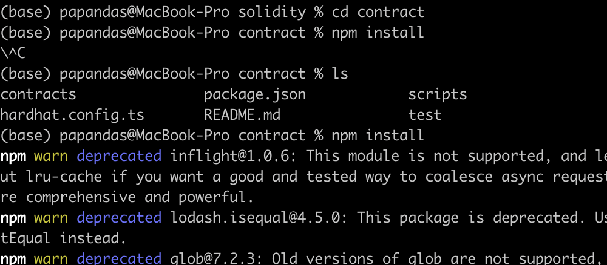
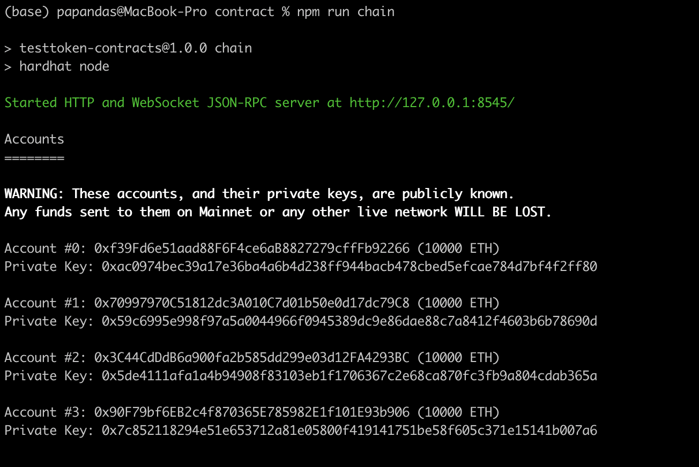
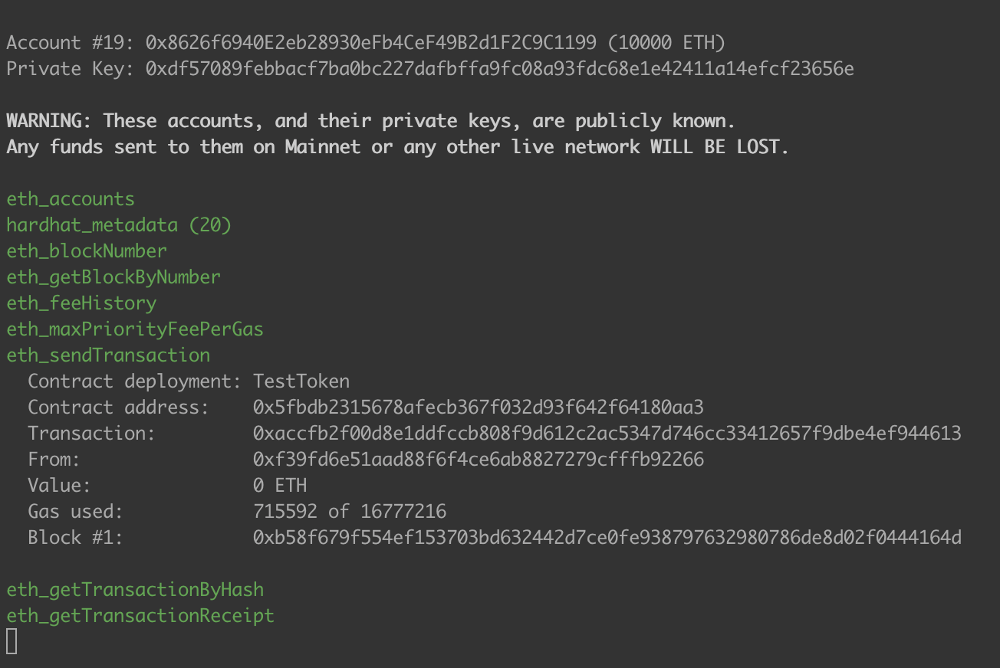
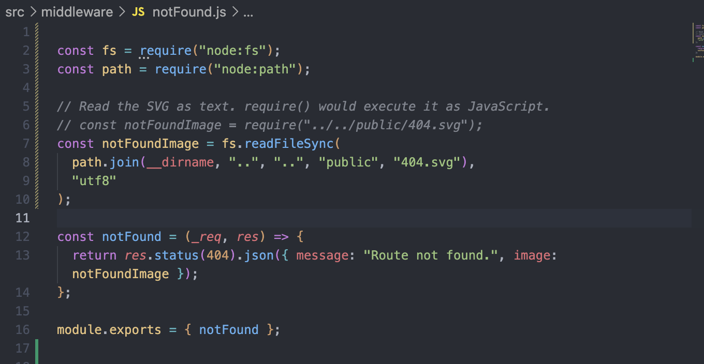

# Skill Test: Papan Das

## Getting the code 

### Step 1. Setup the GitHub repo

### Step 2. Read the task documents first.

I read the root ```README.md```, ```contract/README.md```, both package.json files and both ```.env.example``` files before touching any code. 

Task 1: implement ```TestToken.sol``` so the 7 Hardhat tests pass.
Task 2: deploy it to a local chain and connect the existing ```Express API```.

### Step 3. Read all the source code before running anything. I went through:

* the contract stub, the test file ```test/TestToken.ts```, ```hardhat.config.ts``` and ```deploy.ts```;
every backend file: server, app, config, the blockchain client, services, controllers, routes, validation, middleware and the ABI.

Those custom error names only exist in <b>OpenZeppelin v5</b>, so the contract had to be written for v5.

While reading, I found the red flag: ```src/middleware/notFound.js``` contains ```require("../../public/404.svg"). require()``` on an unfamiliar file extension runs the file as JavaScript. Run untrusted code only after you’ve looked at it, so I inspected the file next.

## The contract (Part 1 of the task)

### Step 4: Installed the contract dependencies. 

I ran ```npm install``` in ```contract/```. That pulls in Hardhat, the Hardhat toolbox (ethers, chai, the test matchers) and OpenZeppelin, as the task’s own setup instructions say.



### Step 5: Ran the tests against the untouched stub

```npm test``` 


All 7 failed, with “Not implemented” and missing custom errors, just as the README predicts. Checking the starting point first proves the test setup works, so a later green run means the code really fixed it.

### Step 6. Checked the installed OpenZeppelin version. 


### Step 7. Checked the OpenZeppelin files work with Solidity 0.8.20. 
Hardhat is pinned to 0.8.20, and some newer OpenZeppelin releases require a later compiler. Every file the token imports (ERC20, ERC20Burnable, Ownable, Context, the interfaces and the error definitions) declares ^0.8.20 or lower, so they compile fine. Skipping this check could have meant a confusing compile error.

### Step 8. Wrote the contract. 

The stub in ```contract/contracts/TestToken.sol``` 


### Step 9: Compiled and ran the tests. 

```npm run compile``` succeeded, and ```npm test``` showed 7 passing:


## Phase 3: Deploy and connect the backend (Part 2 of the task)

### Step 10. Started the local chain and deployed.

1. ```npm run chain``` started a Hardhat node at http://127.0.0.1:8545; this is a blockchain, not the API.



2. ```npm run deploy``` deployed the token and printed `0x5FbDB2315678afecb367f032d93F642f64180aa3`. That’s the usual first address on a fresh Hardhat node, so you’ll likely get the same one.




The deploy uses Hardhat account #0, so account #0 becomes the token owner.

### Step 11. Set up the backend .env and tried to start the API.

1. Copied ```.env.example``` to ```.env``` and set ```CONTRACT_ADDRESS``` to the deployed address.


2. Left ```WALLET_PRIVATE``` as the account #0 key already in the file. That key matters: it’s the same account that deployed the contract, so the API signs as the owner and POST /mint is allowed. A different key would make every mint revert.
   
3. Ran ```npm install``` and ```npm start```.


The API crashed immediately with ```SyntaxError: Unexpected token '<'``` from   ```notFound.js```. The README says the backend needs no changes, but as shipped it can never start, so evaluation point 4 (/health OK, endpoints working) couldn’t be met without a fix.

### Step 12. Fixed the 404.svg crash. 

In ```src/middleware/notFound.js```, this line:



### Step 13. Started the API and tested every endpoint. 

I used two Hardhat accounts: account #0 (the owner, which is also the backend wallet) and account #1 (call it “Alice”).


| --- | --- | --- |
| Call	| Result	| What it proves |
| GET /health	| {"status":"OK"}	| The README’s health check passes. |
GET /balance/<owner>	{"balance":1000}	Initial supply went to the deployer, and the API converts base units to whole tokens.
GET /balance/<alice>	{"balance":0}	An empty address reads as 0.
POST /mint {"to":alice,"amount":50}	tx hash	The owner can mint through the API.
GET /balance/<alice>	{"balance":50}	The mint actually landed.
POST /burn {"amount":99999}	error, reverted	Burning more than the balance is blocked.
POST /mint {"to":"nope"}	400	Input validation works.
GET /does-not-exist	404	The fixed 404 handler works.

